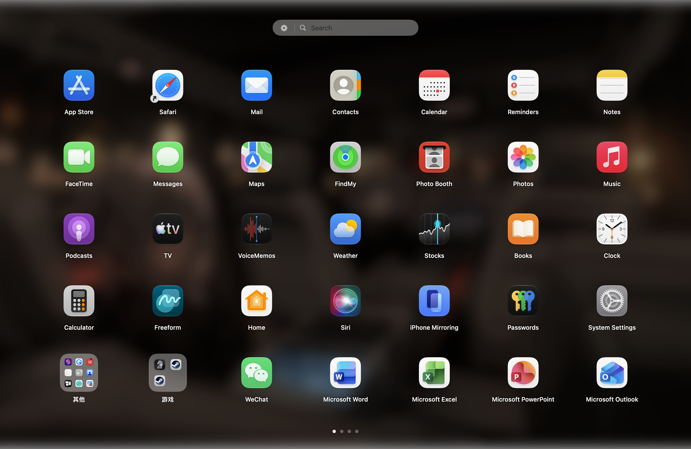

# OpenDeck

A local, from-scratch replacement for macOS Launchpad — written because macOS 26
removed the real one. Everything here is an original implementation: no code, icons,
assets or strings were taken from any existing app.

**English** · [中文说明](README.zh-CN.md)



## What it does

- A full-screen overlay on the display your pointer is on, above all windows, over your
  real wallpaper — five system glass materials, each compositing the live desktop
- An icon grid in eight presets (7–10 columns × 5–6 rows) with horizontal paging, live
  search, folders, and drag to reorder
- Imports your old Launchpad layout, pages and folders included
- Opens from a recorded hot key, F4, the keyboard's Launchpad key, a pinch, or a screen
  corner — and says so when that corner is already a system hot corner
- A menu bar icon, off until you ask for it
- Uninstalls leftovers: scans 12 `~/Library` locations and moves matches to the Trash
- Rescans with FSEvents when apps are installed or removed, and reopens on the page you
  left off on — or on the first page, after a delay you choose
- Right-click any icon for Open, Quit, Force Quit, Show in Finder, Get Info, Hide,
  Uninstall

## Requirements

- **Deployment target:** macOS 15, Apple silicon
- **Developed and tested on:** macOS 27 (26A428)
- Xcode **or** the Command Line Tools. No third-party dependencies

## Build

```sh
./build.sh                 # release -> build/OpenDeck.app
./build.sh debug           # debug
open build/OpenDeck.app

cp -R build/OpenDeck.app /Applications/     # to keep it (and to register "start at login")
```

`build.sh` calls `swiftc` directly — there is no Xcode project and no SwiftPM, so the code
avoids macro-backed property wrappers (`@State`, `@Observable`) and keeps its state in
`ObservableObject` view models.

## Verify

```sh
./build/OpenDeck.app/Contents/MacOS/OpenDeck --selftest    # 343 headless checks
./build/OpenDeck.app/Contents/MacOS/OpenDeck --bench 60    # page-switch timings
```

## Contributing

See [CONTRIBUTING.md](CONTRIBUTING.md).

## License

MIT — see [LICENSE](LICENSE).
